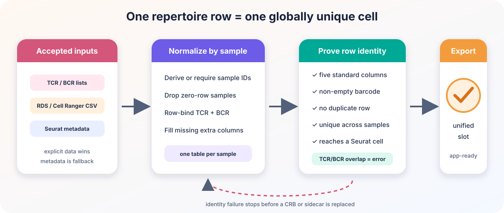

# Data integrity from Seurat to a self-contained Cerebro app

## Why this guide exists

A Cerebro app is the end of a chain:

``` text
Seurat assay -> complete expression matrix -> .crb (+ optional sidecar)
             -> self-contained app bundle -> interactive analyses
```

Each arrow changes representation. A plausible name is not enough to
prove that the correct data crossed the boundary:

- `data.sample_a` may be only one part of a Seurat v5 matrix;
- two repertoire rows with barcode `AAAC-1` may count one cell twice;
- a `.crb` and its sidecar may be left disagreeing by an error late in
  the export.

CerebroNexus therefore uses one rule throughout the chain:

> Resolve identity, validate completeness and uniqueness, stage the
> result, and only then begin replacing published files.

This overview explains how the three contracts fit together. Follow the
linked topic guides for commands and troubleshooting.

## Contract 1: one complete expression matrix

Seurat v5 can represent one logical layer as several physical layers:

``` text
RNA
├── data.donor_a
└── data.donor_b
```

CerebroNexus does not choose a layer because its name merely starts with
`data`. It proves that candidate cell memberships form one unique,
disjoint partition of all assay cells and then joins that partition on a
local object.

An unrelated custom matrix such as `data.imputed` is protected from
[`JoinLayers()`](https://satijalab.github.io/seurat-object/reference/SplitLayers.html).
A deeper complete split such as `data.imputed.donor_a/donor_b`,
requested as `data`, is semantically ambiguous and stops with an
explanation instead of silently becoming normalized data.

Every operation that describes the complete object applies the same
final check:

``` text
unique matrix cells == unique Seurat object cells
```

If the sets match but order differs, CerebroNexus reorders the matrix
once. Missing or unexpected cells are an error.

For the complete algorithm, diagrams, performance limits, and
troubleshooting, see [Seurat v5 layered
assays](https://mihem.github.io/CerebroNexus/articles/seurat_v5_layered_assays.md).

## Contract 2: one repertoire row per cell

The immune-repertoire module treats a row as one cell carrying one
clonotype. That only works if barcode identity is unique.



The canonical structure is:

``` r
repertoire <- list(
  donorA = data.frame(
    barcode = c("donorA_AAAC-1", "donorA_TTGC-1"),
    CTgene = c("TRAV1.TRAJ1", "IGHV1.IGHJ1"),
    CTnt = c("TGT...", "TGC..."),
    CTaa = c("CAV...", "CAR..."),
    CTstrict = c("TRAV1;CAV...", "IGHV1;CAR...")
  )
)
```

The contract requires:

- one named data frame per sample;
- all five standard identity/clone-call columns;
- each required column is a one-dimensional vector with one value per
  row;
- a non-empty barcode in every row;
- no duplicate barcode in a sample;
- no barcode reused by another sample;
- no cell present in both TCR and BCR inputs.

TCR and BCR tables for the same sample are row-bound only after the
overlap check. Zero-row sample tables are treated as absence.

### Barcode overlap with the Seurat object

No overlap is an error: the app could not attach any receptor to any
cell. A common cause is `combineTCR(samples = ...)` adding sample
prefixes while the Seurat cell names were not changed with
[`RenameCells()`](https://satijalab.github.io/seurat-object/reference/RenameCells.html).

Partial overlap is ordinary after cells have been filtered, but orphan
rows must not remain analysis units. They are removed with a warning
before storage. A whole unmatched sample is therefore removed; if every
sample is unmatched, the operation stops.

### Unified and separate TCR/BCR input

A valid `@misc$immune_repertoire` is authoritative. Stale
`@misc$tcr_data`/`@misc$bcr_data` slots on the Seurat object do not
block it.

When only those two slots exist,
[`exportFromSeurat()`](https://mihem.github.io/CerebroNexus/reference/exportFromSeurat.md)
validates them and merges them into the one unified repertoire. The
`.crb` stores only that unified repertoire; the Cerebro object has no
`tcr_data` or `bcr_data` fields, and `getTCR()` / `getBCR()` derive
their tables from it. A `.crb` from an older release that still carries
those fields is a retired format; see [Retired
formats](#retired-formats).

See [Immune repertoire
analysis](https://mihem.github.io/CerebroNexus/articles/immune_repertoire_analysis.md)
for Cell Ranger inputs, metadata extraction, scRepertoire integration,
and module use.

## Contract 3: stage CRB and sidecar replacement

An export can produce:

``` text
embedded -> dataset.crb
h5       -> dataset.crb + dataset.h5
```

An H5-backed `.crb` is *thin*: the cell names are stored once, in the H5
file (`/expression/genes`), and the `.crb` keeps only their order and a
checksum (see [Thin H5 CRBs](#thin-h5-crbs)). A very large immune
repertoire can add one more sibling file, `dataset.immune.qs2`, so the
Viewer lists samples and chains without reading it. With the default
`immune_sidecar = "auto"` this happens only for `h5` exports whose
repertoire has at least `immune_sidecar_threshold` (100,000) rows;
`"always"` and `"never"` override that.

All artifacts are written in a private sibling stage. On POSIX systems
the stage is mode `0700`, new H5, immune sidecar and CRB files are
`0600`; an existing CRB keeps its previous mode. Only those POSIX mode
bits are set or preserved. Ownership, ACLs, extended attributes, and
security labels remain the deployment system’s responsibility on every
platform. Later validation of repertoire, HLA, markers, projections, and
spatial data happens before publication.

Before replacing an existing sidecar, the exporter reads the current
CRB’s plain backend field without calling a serialized getter.
Replacement proceeds only when that descriptor claims the exact sidecar
path and type; an unrelated same-name file is a collision and remains
untouched; the same holds for the immune repertoire sidecar. If
publication fails, the previous CRB and sidecars are restored on a
best-effort basis. A successful backend switch removes the previous
sidecar only after the new CRB is committed.

This is not an atomic transaction across two paths. Stop every app or
other reader using the export before replacing it: a live reader can
otherwise load the old CRB during the sidecar swap. Process termination
and concurrent writers are also outside the guarantee. A failed
restoration is reported rather than hidden.

The `h5` mode requires a portable `.crb` filename. Empty stems, Windows
reserved names, and filesystem-invalid punctuation are rejected before
any artifact is written.

### Thin H5 CRBs

For an H5-backed export,
[`HDF5Array::writeTENxMatrix()`](https://rdrr.io/pkg/HDF5Array/man/writeTENxMatrix.html)
stores the matrix cells by genes, so the file’s `/expression/genes`
dataset holds the **cell** names and `/expression/barcodes` the **gene**
names. The `.crb` (thin-CRB schema version 3) then drops
`meta_data$cell_barcode` and the row names of every projection that
carries the same cell names, and records a checksum of the cell names
(`cell_names_hash`), the cell count, and which projections were
compacted in its `crb_schema` field.

When the `.crb` is loaded,
[`readCerebro()`](https://mihem.github.io/CerebroNexus/reference/readCerebro.md)
and the Viewer read the cell names back from the H5 file, verify them
against the checksum and restore both fields. A `.crb` paired with the
wrong H5 file, or an H5 file whose cells were reordered, therefore stops
with an error instead of attaching expression to the wrong cells. An
H5-backed `.crb` written by CerebroNexus 5.1.x without a `crb_schema`
field is still read as it is; every new H5 export is thin.

### Retired formats

The readers accept only the current layout.
[`readCerebro()`](https://mihem.github.io/CerebroNexus/reference/readCerebro.md),
[`launchCerebro()`](https://mihem.github.io/CerebroNexus/reference/launchCerebro.md),
[`createShinyApp()`](https://mihem.github.io/CerebroNexus/reference/createShinyApp.md)
and the Viewer all reject a `.crb` that

- has no `expression_backend` descriptor;
- has a thin schema other than version 3;
- still stores receptors in non-empty `bcr_data` / `tcr_data` fields;
- records an immune repertoire sidecar of any type other than `"file"`;
- predates spatial support (the Cerebro v1.3 class), HLA typing support,
  Trekker support or the enriched-pathways page, so its stored object
  lacks the `availableSpatial()`, `getHLATyping()`, `getTrekker()` or
  `getMethodsForEnrichedPathways()` method.

The message is the same everywhere:

``` text
The Cerebro data file 'x.crb' uses a retired format: <reason>.
Convert it once with CerebroNexus::convertCerebro().
```

[`convertCerebro()`](https://mihem.github.io/CerebroNexus/reference/convertCerebro.md)
is the only migration path. It sets a missing descriptor to `embedded`,
rebuilds an object that lacks one of those methods on the current class,
merges `bcr_data` / `tcr_data` into the unified repertoire and thins an
H5-backed `.crb` that was written without a schema. A `.crb` whose
expression storage this version cannot read or repair (an expression
backend other than `embedded` or `h5`, thin schema 1 or 2, an immune
sidecar of another type than `"file"`) cannot be converted; re-export it
from the source Seurat object with
`exportFromSeurat(expression_matrix_mode = "h5")`.

``` r
CerebroNexus::convertCerebro("old_dataset.crb")
```

## What errors versus warnings mean

Errors mean that continuing would reinterpret identity or publish an
unusable artifact:

- ambiguous/incomplete expression partition;
- matrix/object cell mismatch;
- target-path collision;
- missing or escaping bundle input;
- malformed or duplicate repertoire identity;
- zero repertoire/cell overlap.

Warnings mean that the result remains interpretable:

- repertoire rows or samples absent from the object were removed;
- publication succeeded but an old backup could not be removed.

## Recommended workflow

1.  Keep source Seurat layers in memory for export, or materialize every
    intended split layer first.
2.  Export to a `.crb` path and choose `embedded` or `h5`.
3.  Add repertoire data through
    [`addImmuneRepertoire()`](https://mihem.github.io/CerebroNexus/reference/addImmuneRepertoire.md)
    rather than assigning an unchecked shape.
4.  Keep the H5 file, and the immune repertoire sidecar if there is one,
    beside its CRB under the names recorded in the CRB.
5.  Build the app with
    [`createShinyApp()`](https://mihem.github.io/CerebroNexus/reference/createShinyApp.md)
    and treat any error it raises as a request to fix identity, not as a
    file-copy inconvenience.
6.  Move or deploy the resulting app directory as one unit.

## Further reading

- [Seurat v5 layered
  assays](https://mihem.github.io/CerebroNexus/articles/seurat_v5_layered_assays.md)
- [Create a self-contained Shiny
  app](https://mihem.github.io/CerebroNexus/articles/create_a_self_contained_shiny_app.md)
- [Immune repertoire
  analysis](https://mihem.github.io/CerebroNexus/articles/immune_repertoire_analysis.md)
- [Create an H5 expression
  matrix](https://mihem.github.io/CerebroNexus/articles/create_expression_matrix_in_h5_format.md)
