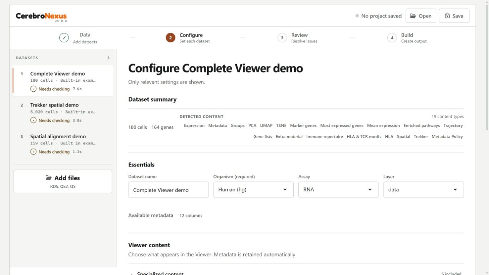

```{r setup, include = FALSE}
knitr::opts_chunk$set(echo = TRUE, eval = FALSE)
```

# What the Builder does

The Dataset Builder turns trusted Seurat objects into a reviewed CerebroNexus release without requiring you to assemble a long export call. It uses the same export and app-generation code as the R API, but presents the choices as four guided stages:

1. **Data** — add datasets or open a saved project.
2. **Configure** — set each dataset, included content and spatial views.
3. **Review** — resolve issues and confirm the release plan.
4. **Build** — create CRB bundles or a Viewer App.

The Builder is a local authoring tool. It can deserialize executable R objects, so use only files you trust and do not deploy it as an upload service for untrusted users.

# Launch the installed Builder

```{r}
# Open the local point-and-click Builder.
library(CerebroNexus)
launchCerebroBuilder()
```

The launcher opens a browser on a free local port. Use `launchCerebroBuilder(port = 7799)` to choose a port or `launchCerebroBuilder(launch_browser = FALSE)` when another process will open the page.

The launcher always runs the Builder shipped inside the installed package. If you are developing CerebroNexus itself, reinstall the package before checking the final user experience.

## Dependencies

Install CerebroNexus with its declared Imports, then install the optional packages needed by your workflow:

| Workflow | Additional packages |
| --- | --- |
| Builder and Seurat input | `Seurat` and `SeuratObject` |
| Legacy `.qs` input | `qs` (`.qs2` uses the imported `qs2` package) |
| Login-enabled App | `shinymanager >= 1.1.0` |
| BPCells expression backend | `BPCells` (GitHub remote declared in `DESCRIPTION`) |
| HDF5 expression backend | Bioconductor `rhdf5` and, for HDF5Array input, `HDF5Array` |
| Spatial PNG/JPEG images | `png` and `jpeg` |

Legacy `.qs` input requires a working `qs` installation. The default Nix
environment omits it because `qs 0.27.3` is
incompatible with its R 4.6 runtime. For that environment, first convert legacy
files to `.rds` or `.qs2` in an R environment where `qs` can read them. RDS and
qs2 input remain available without `qs`.

Builder checks the dependencies of selected analyses before Build. The exact supported environment is recorded in `DESCRIPTION` and the repository's `default.nix`; installing the package alone does not install every Suggests entry. A standalone App still needs R and its runtime packages on the destination host.

# 1. Data

Choose **Add files** (or drop files anywhere on the page) to add Seurat or SingleCellExperiment objects stored as `.rds`, `.qs2` or `.qs`, AnnData `.h5ad`, MuData `.h5mu`, or a zipped SpatialData store, or choose **Load example datasets**. Available formats depend on the installed readers; a format whose reader is missing is listed under the add button with the reason.

The example action loads three synthetic datasets: **Complete Viewer demo**, **Trekker spatial demo** and **Spatial alignment demo**. The first covers analysis tables, gene lists, trajectories, supplementary material, immune repertoire, HLA and spatial content; the second provides four tissue images; the third demonstrates an arrow-shaped section with a preset background alignment.

The complete example also ships marker, supplementary-table and histology attachments for the explicit content controls. The arrow example's background is configured automatically; this does not imply that arbitrary uploaded images are aligned automatically.

Patient, section, FOV, and image identities are explicit: a tissue photograph is not a new spatial FOV. Gallery and file inputs use **distinct source adapters**, then join the **shared import pipeline** for inspection, recommendations, snapshots, Review, and Build.

After loading, the dataset summary reports cells, genes, detected content, attention items, and blockers. A dataset is registered only after the worker has loaded it, profiled it, and created an immutable session-private snapshot. File-backed storage needed by the object is copied into that snapshot as well.

This isolation makes retry and worker restart repeatable, but it is not free: the **snapshot disk cost** can approach the size of the object plus its backing files. Snapshots have owner-only permissions and are cleaned when the session releases them. If the complete storage closure cannot be frozen safely, import stops before the dataset becomes Ready.

Use the dataset rail to select, reorder or remove datasets. Review the initial dataset and Viewer launch settings before building the App.

# 2. Configure



**Essentials**, **Viewer content** and **Views** contain the configuration choices:

- dataset name and organism;
- default metadata group and default projection;
- assay and logical layer;
- UMI and feature-count columns;
- embedded, HDF5, or BPCells expression storage.

Only choices proven valid by inspection are offered. Advanced technical settings remain available under a disclosure, while the recommended novice path stays visible. The chosen group and projection become the generated Viewer's actual startup defaults and remain members of the frozen included sets.

Colour palettes belong to the generated App configuration, not to the CRB format. A CRB opened elsewhere therefore uses Viewer defaults, while the App starts with the per-dataset and per-group colours frozen by the Builder.

## Optional content and analyses

The optional-analysis and attachment controls distinguish requested work from content already present on the object. The Builder can opt in to mitochondrial/ribosomal percentages, most-expressed genes, marker genes, and Enrichr enrichment from an explicitly selected marker method. Every analysis states its dependencies, estimated cost, network use, and replacement policy before it enters the plan.

Valid existing marker tables, enrichment, `monocle2` trajectories, immune repertoire, HLA typing, spatial content, Trekker content, extra tables, and extra plots are preserved or normalized according to the manifest. Supplementary CSV/TSV/TXT tables and PNG/JPEG histology images can be attached through their explicit controls.

For spatial data, each FOV has its own coordinates; a tissue section can own several labelled images (for example H&E and DAPI). The alignment view overlays one selected PNG or JPEG on its FOV and records its own bounds and transform. Coordinates-only FOVs remain valid. TIFF and OME-TIFF require conversion before import.

Selected analysis failures are never presented as successful partial work. The result becomes **Needs decision**: retry the failed item with its dependency closure, or remove it explicitly, return to Review, and freeze a new plan.

When a dataset is configured, use **Finish Checking**. Check the remaining datasets before proceeding to Review.

# 3. Review

Review is an exact, immutable description of the frozen plan that Build will execute. It shows the plan revision, dataset order, output filenames, expression backends, analysis dependencies, content dispositions, expected Viewer pages, App settings, planned payload targets, replacement policy, and estimated runtime and disk. Publication later adds `build-report.json` and `.cerebro-builder-release-v1`, matching the final release tree below.

In **Build**, choose one artifact mode:

- **CRB-only** releases the CRBs and any HDF5/BPCells sidecars.
- **Public App** releases `cerebro_app/`; its private data directory contains
  the CRBs and sidecars.
- **Login App** does the same, and adds `cerebro_app/viewer-auth.env` inside
  the release.
  In Build, select **Require login**, add each local account, then Build and
  open the generated App from its release directory to verify the local login.
  Keep `viewer-auth.env` with the App when moving a release; never commit it to
  Git or place it in a web-accessible directory.

Review's disk estimate counts the source **snapshot payload once** per dataset; it is not a prediction of the complete release size. An App contains a private data copy, and the report and ownership record add further release-visible files.

# 4. Build

Pressing Build creates a single-flight request from the frozen snapshot. Draft controls cannot change that request. Cancellation is available while the worker is preparing artifacts; once the short final publication transaction begins, it runs to a safe terminal state instead of being interrupted between renames.

## Private storage is not a public URL

The generated App keeps CRBs and HDF5/BPCells sidecars under `private-data/`. That directory is not registered as a Shiny static resource. The `viewer_bundle_assets` list records private runtime inputs that are eligible to be copied into the bundle; membership is not HTTP exposure. Spatial images are read by the server and embedded as data URIs. Direct requests for CRBs, sidecars, private data, build reports, and spatial source files return no file.

This is a packaging boundary, not a substitute for host authentication. Deploy the generated App only on infrastructure whose access policy matches the data.

## Save a project or run a release

**Save** stores an editable project with `builder-project.json`, managed sources, attachments and reusable artifacts. **Open** restores it for further work. Login passwords and the database passphrase are not saved in the project, so provide accounts again when building a login-enabled release. A project is a working directory; the release below is the separate deliverable.

Run `shiny::runApp("path/to/release/cerebro_app")` for a Viewer App. On Linux, run `bash viewer/start-linux.sh` from `cerebro_app/` to prepare login-file permissions and start it, including after a Windows transfer. For a service account use `sudo bash viewer/start-linux.sh --prepare-only --user shiny`, replacing `shiny` with the actual account, then start the service normally. The bundled `viewer/AUTHENTICATION-DEPLOYMENT.md` explains parent-directory access, read-only storage and external secrets.

# Results, replacement, and recovery

A successful result names the published artifacts. Every published release offers **Reveal Folder**, **Copy Path**, and **Copy Report**. The report is portable and redacted; it describes artifact-visible datasets, methods, and metadata columns without source paths, host/PID data, lock paths, or raw values.

One release is published as a transaction:

```text
CRB-only release
├── 01-<dataset>.crb
├── build-report.json
└── .cerebro-builder-release-v1

Public App release
├── cerebro_app/
│   └── private-data/01-<dataset>.crb
├── build-report.json
└── .cerebro-builder-release-v1

Login App release
├── cerebro_app/
│   ├── viewer-auth.env
│   └── private-data/
│       ├── 01-<dataset>.crb
│       └── auth/credentials.sqlite
├── build-report.json
└── .cerebro-builder-release-v1 ```

The coordinator writes into a private same-filesystem stage, validates the whole payload, moves the prior release to a backup, renames the stage into place, verifies the final location, and only then retires the backup. Ordinary failures use rollback and leave the previous release intact. If process death interrupts the two-rename window, conservative recovery restores or preserves the old release rather than claiming zero downtime.

The ownership record lists every Builder-owned release member. A later build can safely remove an old App or dataset only when that record proves ownership; foreign or symbolic entries block replacement and remain untouched. For **ownership migration**, a legacy release without a record can be replaced only when its complete topology remains in the new plan. Shrinking it requires a record-bearing publication first or explicit manual resolution.

# Supported inputs and limits

- Input adapters cover trusted Seurat and SingleCellExperiment files, AnnData,
  MuData, zipped SpatialData and the shipped examples. CRB, h5Seurat, loom, and
  remote-upload adapters are not implemented.
- The Builder does not generate trajectories, GSEA, Trekker mappings, or extra
  plots. It preserves supported existing forms and diagnoses unsupported ones.
- Only `monocle2` trajectories are exported. Other methods are reported as
  filtered rather than disappearing silently.
- Histology attachment accepts PNG/JPEG; TIFF and OME-TIFF need conversion.
- Colours and Viewer launch options belong to a generated App, not a bare CRB.
- Publication protects the prior release and supports recovery, but it does not
  promise uninterrupted service through process death during final replacement.

These boundaries keep Review truthful: content is described as configured, generated, attached, converted, preserved, stored only, filtered, or blocked according to what the current exporter and Viewer can actually support.
