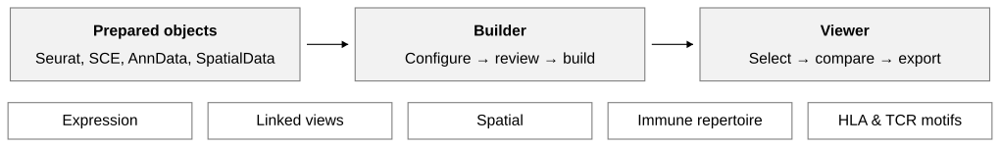

```{r, include = FALSE}
knitr::opts_chunk$set(
  collapse = TRUE,
  comment = "#>",
  eval = FALSE
)
## The Builder screenshots appear on the website only: they are left out of
## the package (see .Rbuildignore), and pkgdown sets IN_PKGDOWN. Their chunks
## set fig.class, because pkgdown inverts images of the class r-plt in dark mode.
builder_figure <- function(file) {
  path <- file.path("..", "man", "figures", file)
  if (identical(Sys.getenv("IN_PKGDOWN"), "true") && file.exists(path)) {
    knitr::include_graphics(path)
  }
}
```

```{r overview, echo = FALSE, eval = TRUE, out.width = "100%", fig.cap = "The CerebroNexus workflow, with the main areas of the Viewer below.", fig.alt = "Prepared objects (Seurat, SingleCellExperiment, AnnData, SpatialData) go into the Builder (configure, review, build); the Viewer opens the result (select, compare, export). Below, the main areas of the Viewer: expression, linked views, spatial, immune repertoire, and HLA and TCR motifs."}

```

CerebroNexus is compatible with Seurat, SingleCellExperiment and AnnData
(scanpy) objects, and with SpatialData stores. It shows an analysis that is
already done: quality control, normalization, clustering and embeddings stay in
the toolkit you already use. For the preprocessing steps, please see:

* [Seurat tutorials](https://satijalab.org/seurat/)
* [Orchestrating Single-Cell Analysis with Bioconductor](https://bioconductor.org/books/release/OSCA/)
  for SingleCellExperiment
* [scanpy tutorials](https://scanpy.readthedocs.io/en/latest/tutorials/basics/index.html)

Importing turns your object into a `.crb` file, which the Viewer opens. The
Builder does this by pointing and clicking; in R, the `convert*()` functions do
the same.

# With the Builder

```{r builder}
library(CerebroNexus)
launchCerebroBuilder()
```

The Builder opens in your browser. It needs a few suggested packages, such as
Seurat; see the
[installation instructions](https://www.mheming.com/CerebroNexus/#id_1-installation).

1. **Data**: add your files, or click **Load example datasets** to try the
   Builder with three examples. It reads Seurat and SingleCellExperiment objects
   saved as `.rds` or `.qs2`, AnnData `.h5ad` and MuData `.h5mu` files, and a
   `.zip` of a SpatialData `.zarr` folder.
2. **Configure**: check the name, organism, assay and layer of each data set,
   choose what the Viewer shows, then click **Finish Checking**.

```{r builder-configure, echo = FALSE, eval = TRUE, out.width = "100%", fig.class = "img-fluid", fig.alt = "The Configure step of the Builder with the three example data sets."}
builder_figure("builder.png")
```

3. **Review**: confirm what will be built.

```{r builder-review, echo = FALSE, eval = TRUE, out.width = "100%", fig.class = "img-fluid", fig.alt = "The Review step of the Builder: everything is ready to build."}
builder_figure("builder-review.png")
```

4. **Build**: choose a Viewer app or CRB files only, set what visitors see
   first, click **Build** and choose a folder. When the build is complete,
   **Open App** starts the result.

```{r builder-build, echo = FALSE, eval = TRUE, out.width = "100%", fig.class = "img-fluid", fig.alt = "The Build step of the Builder after a complete build, with the Open App button."}
builder_figure("builder-build.png")
```

The Builder can also add most expressed genes, marker genes and other tables,
and offers PAGA, scVelo and pseudotime trajectories next to monocle2. See
[Build a data set without writing code](https://www.mheming.com/CerebroNexus/articles/build_a_data_set_by_pointing.html)
for all options.

# With R

Four kinds of input lead to a `.crb` file:

| You have | Convert with |
|---|---|
| Seurat object (`.rds`, `.qs2`) | `convertSeuratToCerebro()` |
| SingleCellExperiment (`.rds`, `.qs2`) | `convertSCEToCerebro()` |
| AnnData / scanpy file (`.h5ad`), MuData (`.h5mu`) | `convertH5adToCerebro()` |
| SpatialData store (`.zarr`) | `convertSpatialDataToCerebro()` |

`convertSeuratToCerebro()` and `convertSCEToCerebro()` take either the object
in memory or a file path, and write the `.crb` file into `result_dir`. To choose
the file name yourself, use `exportFromSeurat()` or `exportFromSCE()`, which take
an object and a `file` argument; set `nUMI` and `nGene` to the meta data columns
that hold the number of transcripts and genes per cell.

Because `.crb` is the hub, the formats also convert into each other: a Seurat
object can be written as `.h5ad` for scanpy, an `.h5ad` file can be turned into
a SingleCellExperiment, and so on. AnnData files are read natively with
`rhdf5`; no Python is needed.

## From a Seurat object

```{r seurat}
library(CerebroNexus)

crb <- convertSeuratToCerebro(
  "my_seurat.rds",
  result_dir = "cerebro",
  groups = c("seurat_clusters", "sample"),
  organism = "Human"
)
```

To add tables of marker genes and enriched pathways before the export, see
[Introduction to the CerebroNexus workflow](cerebronexus_workflow_seurat.html).

## From a SingleCellExperiment

```{r sce}
crb <- convertSCEToCerebro(
  "sce.rds",
  result_dir = "cerebro",
  assay = "logcounts",
  groups = c("cluster", "sample")
)
```

## From an AnnData file

```{r h5ad}
crb <- convertH5adToCerebro(
  "pbmc.h5ad",
  result_dir = "cerebro",
  groups = c("louvain", "sample"),
  organism = "Human"
)
```

This takes what scanpy stored, not only the matrix:

* the embeddings in `obsm` (`X_umap`, `X_pca`, ...) as projections;
* the ranked marker genes from `sc.tl.rank_genes_groups`;
* scanpy's category colours (`uns["<column>_colors"]`);
* Visium coordinates and tissue images (`obsm["spatial"]`, `uns["spatial"]`),
  one spatial section per library;
* scirpy TCR/BCR tables (`airr` argument) and PAGA / scVelo / pseudotime
  trajectories.

Use `use_raw = TRUE` for `adata.raw`, `modality =` to pick one modality of an
`.h5mu` file, and `gene_names =` to name genes by a `var` column when the index
holds Ensembl IDs.

## From a SpatialData store

```{r spatialdata}
crb <- convertSpatialDataToCerebro(
  "visium.zarr",
  result_dir = "cerebro",
  groups = c("region", "in_tissue"),
  organism = "Mouse"
)
```

The cell table, the coordinates and the tissue pictures are read from the
`.zarr` directory, with one spatial section per region. Coordinates come from
`obsm["spatial"]` when the table has them (Visium) and from the shapes the
table annotates otherwise (MERFISH, Xenium). Stores compressed with Blosc
(lz4, zstd or zlib), zstd or gzip are read; a store that needs another codec
stops with the codec's name. Blosc chunks are decoded in R, lz4 (the numcodecs
default) at about 4 MB/s, so re-save a large store with zstd, or use an
`.h5ad` file.

## Back to scanpy

```{r back}
exportToH5ad("cerebro/cerebro_pbmc.crb", "pbmc_back.h5ad")
```

```python
import anndata as ad
adata = ad.read_h5ad("pbmc_back.h5ad")
```

Expression, cell metadata, projections, marker genes, category colours and, for
spatial data, coordinates and tissue images are written. A message lists what
`.h5ad` has no place for (immune repertoire, trajectories, trees, ...).

# Next steps

* Open the `.crb` file with `launchCerebro()`, or the app the Builder made with
  **Open App**.
* To add CerebroNexus analyses to a Seurat object first (marker genes,
  enriched pathways, gene set enrichment), see
  [Introduction to the CerebroNexus workflow](cerebronexus_workflow_seurat.html).
* To share the result, see
  [Share data sets as a Shiny app](https://www.mheming.com/CerebroNexus/articles/create_a_self_contained_shiny_app.html).
